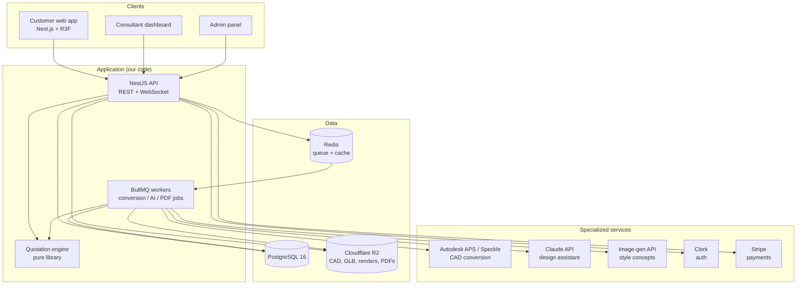
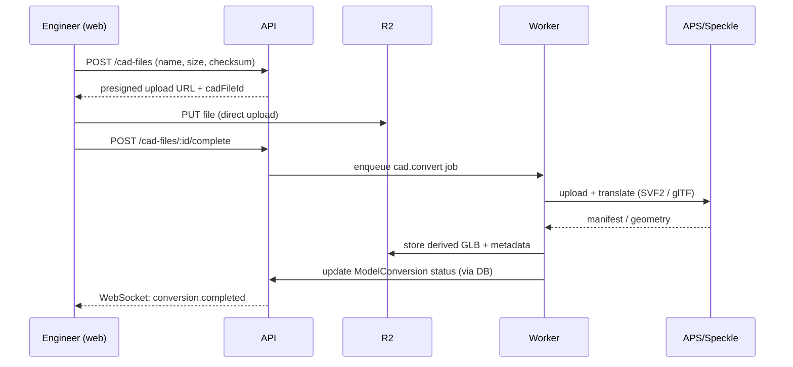

# 01 — System Architecture

## Principles

1. **Buy the solved problems, build the differentiator.** CAD conversion, rendering engines, auth, and payments are bought (APS/Speckle, Three.js, Clerk, Stripe). The design studio, consultant workflow, catalog, and quotation engine are ours.
2. **Provider-agnostic adapters at every vendor boundary.** Each third party sits behind an interface owned by us (`CadConversionProvider`, `ImageGenProvider`, `StorageProvider`). Swapping a vendor must never touch business logic. See [06](06-third-party-services.md).
3. **Immutable design versions.** A submitted design version is never mutated — reviews, quotations, and orders reference a frozen snapshot. Corrections create new versions. This makes the quote legally and technically traceable.
4. **Heavy work is asynchronous.** CAD conversion, AI generation, PDF rendering, and thumbnails run in BullMQ workers, never in HTTP request handlers. The API returns job status; the client polls or listens on WebSocket.
5. **The catalog is the source of commercial truth.** Prices are never stored on designs; they are resolved from the catalog at quotation time and *then* frozen onto quotation lines.

## Context diagram



## Monorepo layout

Turborepo + pnpm workspaces. One repo, atomic changes across API and web.

```
/
├── apps/
│   ├── web/                  # Next.js — customer app, consultant dashboard, admin
│   │   ├── app/              # App Router routes: (customer)/ (consultant)/ (admin)/
│   │   ├── components/
│   │   ├── features/         # feature folders: design-studio/, catalog/, review/ ...
│   │   └── lib/
│   ├── api/                  # NestJS — REST API + WebSocket gateway
│   │   ├── src/modules/      # one module per domain (see 03-api-design.md)
│   │   └── prisma/           # schema.prisma + migrations
│   └── worker/               # BullMQ processors (shares api's modules via packages)
├── packages/
│   ├── shared/               # zod schemas, DTO types, scene JSON schema, money utils
│   ├── quotation/            # pure BOM/quotation engine — no I/O, heavily unit-tested
│   ├── three-kit/            # R3F helpers: loaders, controls, gizmos, instancing utils
│   ├── ui/                   # shadcn-based shared components
│   └── config/               # eslint, tsconfig, prettier presets
├── docs/                     # this folder
└── turbo.json
```

Rules:
- `packages/quotation` and `packages/shared` import **nothing** from apps and perform no I/O. They are the most-tested code in the repo.
- The web app never talks to PostgreSQL, R2, or vendors directly — only to the API. (Exception: direct-to-R2 presigned uploads, issued by the API.)
- The worker reuses the API's service classes through Nest's standalone application context; business logic is written once.

## Key flows

### CAD upload → viewable 3D



Conversion is idempotent per `(cadFileId, pipelineVersion)`: re-running a job must not duplicate artifacts.

### Design save → live price

The editor keeps the scene in a Zustand store. On save, the client POSTs the scene JSON; the API validates it against the zod scene schema, persists a draft `DesignVersion`, and synchronously projects it into `design_items` rows (see [02](02-data-model.md)). The live price shown in the editor is computed **client-side from catalog prices already loaded**, but the server recomputes on every save and the client reconciles — the server number wins.

### Approval → quotation

Consultant approval is a state transition on the design version (`SUBMITTED → APPROVED`). The transition handler calls `packages/quotation` with the frozen scene + current catalog prices, writes `Quotation` + `QuotationLine` rows (prices copied, never referenced), renders the PDF in a worker, and notifies the customer. Approval and quotation creation happen in one DB transaction; PDF rendering is async and retryable.

## Non-functional requirements

| Concern | Target (MVP) |
|---|---|
| API latency | p95 < 300 ms for CRUD; conversion/AI are async jobs |
| 3D first paint | Building shell visible < 5 s on a mid-range laptop, cable/4G |
| Editor frame rate | ≥ 30 fps with a fully furnished room; 60 fps target |
| CAD conversion | < 15 min for typical residential model (job with progress) |
| Availability | Business hours-critical; single-region acceptable for MVP |
| Data durability | PG PITR backups; R2 versioning on the CAD bucket |
| Concurrency | 50 concurrent editing customers without degradation |

## Decisions and their records

| Decision | Status | ADR |
|---|---|---|
| Turborepo monorepo | Accepted | [ADR-001](adr/001-monorepo-turborepo.md) |
| Prisma as ORM | Accepted | [ADR-002](adr/002-prisma-orm.md) |
| Scene = immutable JSONB + projection table | Accepted | [ADR-003](adr/003-design-scene-storage.md) |
| APS vs Speckle | **DECIDE-IN-DISCOVERY** | [ADR-004](adr/004-cad-platform-aps-vs-speckle.md) |
| Shell rendering: glTF-in-R3F vs APS Viewer embed | **DECIDE-IN-DISCOVERY** | [ADR-005](adr/005-building-shell-rendering.md) |
| Clerk for auth | Accepted | [ADR-006](adr/006-clerk-auth.md) |
