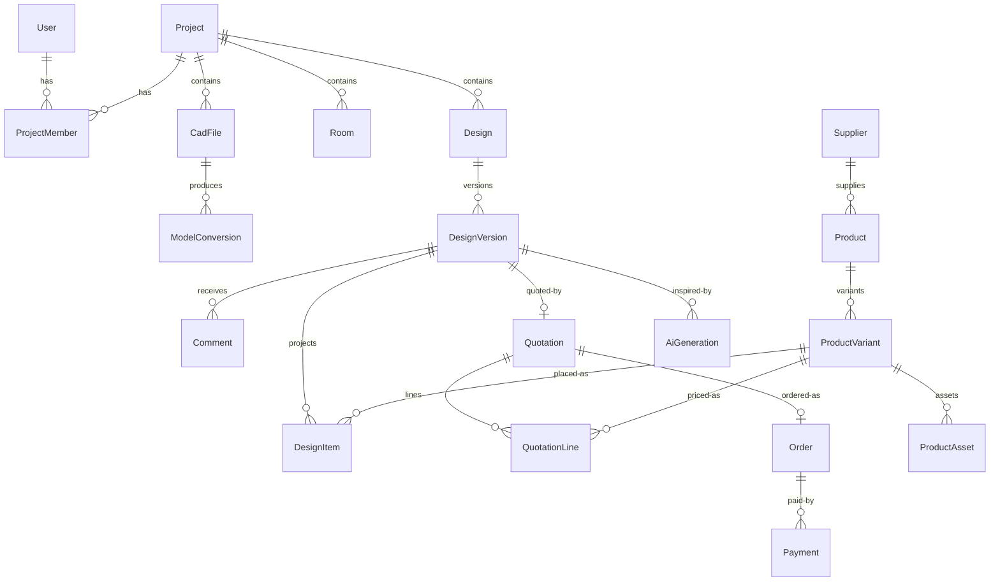

# 02 — Data Model

PostgreSQL 16, managed through Prisma migrations. IDs are `cuid2` strings. All tables carry `createdAt` / `updatedAt`. Soft-delete (`deletedAt`) only where noted — default is hard delete forbidden for anything referenced by a quotation or order.

## Entity overview



## Identity & access

```prisma
model User {
  id        String   @id @default(cuid())
  clerkId   String   @unique          // Clerk is the identity authority
  email     String   @unique
  name      String
  role      Role                       // ENGINEER | CUSTOMER | CONSULTANT | ADMIN
  createdAt DateTime @default(now())
  updatedAt DateTime @updatedAt
}

model ProjectMember {
  projectId String
  userId    String
  role      ProjectRole                // OWNER | EDITOR | VIEWER (within project)
  @@id([projectId, userId])
}
```

Global `Role` gates the app surface (which dashboard you see, admin endpoints); `ProjectMember` gates project data. Both are enforced server-side — see [10-security.md](10-security.md) for the full RBAC matrix.

## Projects & CAD

```prisma
model Project {
  id          String        @id @default(cuid())
  name        String
  status      ProjectStatus // DRAFT | PUBLISHED | ARCHIVED
  address     String?
  // denormalized pointer to the current viewable model
  activeConversionId String?
}

model CadFile {
  id          String   @id @default(cuid())
  projectId   String
  fileName    String
  format      CadFormat   // RVT | IFC | DWG | DXF | GLB_MANUAL
  sizeBytes   Int
  checksum    String      // sha256, dedupe + integrity
  storageKey  String      // R2 object key
  uploadedById String
  status      UploadStatus // PENDING | UPLOADED | FAILED
}

model ModelConversion {
  id              String   @id @default(cuid())
  cadFileId       String
  pipeline        String   // "aps-svf2" | "aps-gltf" | "speckle" | "manual"
  pipelineVersion Int      // bump to force reconversion after pipeline changes
  status          JobStatus // QUEUED | RUNNING | SUCCEEDED | FAILED
  externalRef     String?  // APS URN / Speckle stream id
  outputGlbKey    String?  // R2 key of the derived GLB (shell)
  metadataKey     String?  // R2 key of extracted metadata JSON (rooms, levels, bounds)
  errorMessage    String?
  startedAt       DateTime?
  finishedAt      DateTime?
  @@unique([cadFileId, pipeline, pipelineVersion])
}

model Room {
  id           String  @id @default(cuid())
  projectId    String
  conversionId String  // rooms belong to a specific converted model
  name         String  // "Living Room"
  kind         RoomKind // LIVING | BEDROOM | KITCHEN | BATH | OTHER
  boundsJson   Json    // AABB + floor polygon in model space (meters)
  cameraJson   Json?   // saved default camera pose for room entry
}
```

Rooms come from BIM metadata when available (Revit/IFC spaces) or are drawn by an admin in the guided-modeling tool for 2D inputs. Either way they end up identical here.

## Catalog (commercial source of truth)

```prisma
model Supplier {
  id      String @id @default(cuid())
  name    String
  leadTimeDays Int @default(14)
  active  Boolean @default(true)
}

model Product {
  id          String @id @default(cuid())
  name        String
  category    ProductCategory // SOFA | TABLE | LIGHTING | FLOORING | PAINT | ...
  supplierId  String
  styleTags   String[]        // "modern", "japandi" — feeds AI suggestions
  description String
  active      Boolean @default(true)
}

model ProductVariant {
  id            String @id @default(cuid())
  productId     String
  sku           String  @unique
  name          String  // "Oslo Sofa — 3-seat, Beige"
  // money: integer minor units + currency, ALWAYS
  priceCents        Int
  installCents      Int @default(0)
  deliveryCents     Int @default(0)
  currency          String @default("USD") // ISO 4217
  taxRateBps        Int @default(0)        // basis points, e.g. 500 = 5%
  dimensionsJson    Json    // {w,h,d} in meters — used for placement validation
  unit              Unit    // PIECE | SQM | LITRE  (flooring/paint are per-area)
  active            Boolean @default(true)
}

model ProductAsset {
  id          String @id @default(cuid())
  variantId   String
  kind        AssetKind // GLB | THUMBNAIL | TEXTURE_SET
  storageKey  String
  lodLevel    Int @default(0)   // 0 = full, 1 = medium, 2 = low
  sizeBytes   Int
  licensedFrom String?          // provenance: marketplace order id / "commissioned"
}
```

**Money rules (enforced in `packages/shared/money.ts`):**
- Integer minor units only. No floats, ever, anywhere near money.
- Every monetary column has a sibling `currency`. Mixed-currency quotations are rejected at validation.
- Tax is computed by the quotation engine from `taxRateBps`, not stored per item.

## Designs, versions, and the scene

```prisma
model Design {
  id        String @id @default(cuid())
  projectId String
  name      String
  createdById String
  currentVersionId String?   // pointer to latest version
}

model DesignVersion {
  id         String   @id @default(cuid())
  designId   String
  number     Int      // 1, 2, 3... per design
  status     VersionStatus // DRAFT | SUBMITTED | IN_REVIEW | CHANGES_REQUESTED | APPROVED | REJECTED
  sceneJson  Json     // THE design. Immutable once status != DRAFT.
  sceneSchemaVersion Int // versioned scene format, see below
  createdById String
  submittedAt DateTime?
  reviewedById String?
  reviewedAt  DateTime?
  thumbnailKey String?
  @@unique([designId, number])
}

// Projection of sceneJson for queries/pricing. Rebuilt on every save;
// NEVER hand-edited. sceneJson is the source of truth.
model DesignItem {
  id           String @id @default(cuid())
  versionId    String
  roomId       String
  variantId    String     // -> ProductVariant
  quantity     Decimal    // pieces, or sqm/litres for area-based units
  transformJson Json      // position/rotation/scale (meters, radians)
  @@index([versionId])
  @@index([variantId])
}
```

### Scene JSON (schema in `packages/shared/scene/v1.ts`, validated with zod)

```jsonc
{
  "schemaVersion": 1,
  "conversionId": "cnv_abc",           // which building model this design targets
  "rooms": {
    "room_livingroom": {
      "wallFinish": { "variantId": "var_paint01", "areaSqm": 42.5 },
      "floorFinish": { "variantId": "var_oak02", "areaSqm": 28.0 },
      "items": [
        {
          "id": "itm_01",              // stable per-item id for comments/undo
          "variantId": "var_sofa_oslo3_beige",
          "position": [1.2, 0.0, 3.4], // meters, Y-up
          "rotationY": 1.5708,
          "scale": 1.0
        }
      ],
      "lighting": { "preset": "warm-evening" }
    }
  }
}
```

Rules:
- `schemaVersion` is mandatory. Readers must handle N and N-1; migrations of stored scenes are explicit scripts.
- Every quotable choice references a `variantId`. If it doesn't have a variantId, it cannot affect the price — by construction.
- Transforms are meters / radians / Y-up. Same convention as our GLB assets ([04](04-cad-3d-pipeline.md)).

## Review, quotation, order

```prisma
model Comment {
  id         String @id @default(cuid())
  versionId  String
  authorId   String
  roomId     String?
  itemRef    String?   // scene item id ("itm_01") — comment pinned to an object
  body       String
  resolvedAt DateTime?
}

model Quotation {
  id          String @id @default(cuid())
  versionId   String @unique   // exactly one quotation per approved version
  number      String @unique   // human ref "Q-2026-00042"
  status      QuoteStatus      // ISSUED | ACCEPTED | EXPIRED | CANCELLED
  currency    String
  subtotalCents Int
  taxCents      Int
  totalCents    Int
  validUntil  DateTime
  pdfKey      String?
}

model QuotationLine {
  id          String @id @default(cuid())
  quotationId String
  variantId   String
  description String   // frozen human text
  quantity    Decimal
  unitPriceCents Int    // FROZEN copy of catalog price at approval time
  installCents   Int
  deliveryCents  Int
  taxRateBps     Int
  lineTotalCents Int
  roomName    String    // frozen for the PDF
}

model Order {
  id          String @id @default(cuid())
  quotationId String @unique
  number      String @unique  // "O-2026-00017"
  status      OrderStatus     // PENDING_PAYMENT | PAID | IN_FULFILLMENT | COMPLETED | CANCELLED
  stripePaymentIntentId String?
}

model Payment {
  id       String @id @default(cuid())
  orderId  String
  provider String  // "stripe"
  providerRef String @unique  // payment intent id — idempotency anchor
  amountCents Int
  currency String
  status   PaymentStatus // PENDING | SUCCEEDED | FAILED | REFUNDED
  rawEventJson Json      // last webhook payload for audit
}
```

**Freezing rule:** `QuotationLine` copies price, tax, and description at approval time. Later catalog edits never change an issued quotation. Reissuing requires a new design version → new approval → new quotation.

## AI artifacts

```prisma
model AiGeneration {
  id         String @id @default(cuid())
  versionId  String?    // design version it was generated for (nullable: exploration)
  roomId     String
  kind       AiKind     // STYLE_CONCEPT | ASSISTANT_THREAD
  provider   String     // "openai-images" | "gemini" | "anthropic"
  promptJson Json       // full prompt + params for reproducibility
  outputKeys String[]   // R2 keys of generated images
  costCents  Int        // tracked per generation for cost dashboards
  createdById String
}
```

## Audit log

Every state transition on `DesignVersion`, `Quotation`, `Order`, plus all admin catalog mutations, writes an `AuditEvent { actorId, entity, entityId, action, beforeJson, afterJson }` row. Written in the same transaction as the change.

## Migration policy

- Schema changes only via `prisma migrate dev` → committed migration files. No `db push` outside local scratch DBs.
- Destructive migrations (drop/rename) require a two-step deploy: additive migration + code reading both → backfill → removal migration.
- Every migration PR includes the updated section of this document.
